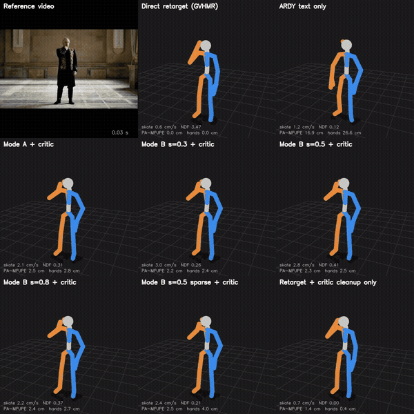

# video2ardy — video-driven motion synthesis for NVIDIA ARDY

Text-to-motion models only know the actions their text encoder can name. This experiment uses a
**video** as the acting reference instead (here, clips generated from rich prompts by a
text-to-video model) and turns it into an animation produced by
[ARDY](https://github.com/nv-tlabs/ardy). ARDY is guided by sparse key-constraints taken from the
video and by SDEdit-style initialisation from the video's own latent tokens.

**What this shows, and what it does not** (five 5-second clips, one seed, stick-figure renders):

- It shows that a text-to-video clip carries acting that ARDY's text prompt cannot produce, and that
  ARDY's constraints reproduce it to about 3 cm at the hands, inside a continuous ARDY sequence.
- It does not show that passing through ARDY makes the motion better than the video estimate.
  On the metrics that do not depend on our critic, the ARDY outputs have slightly more foot sliding
  and 2 to 3.5 times the angular jerk of the plain retarget. The row "retarget + critic cleanup only",
  which does not use ARDY, is the best one on almost every per-clip metric.
- What ARDY adds is integration: the result is native ARDY motion that joins other ARDY motion
  without a seam, can be driven from sparse keys, and can fill a stretch where the video is broken.



*Reference video (Wan 2.1) · direct GVHMR retarget · ARDY text only · Mode A · Mode B 0.3/0.5/0.8 ·
Mode B sparse · critic cleanup only. The full side-by-side for five clips is in
[`results/comparison_5clips.mp4`](results/comparison_5clips.mp4).*

## Pipeline

```
rich text prompt ──(Wan 2.1 T2V 1.3B, optional)──► reference video (.mp4)
        │
        ▼  1. video_extractor.py      GVHMR → world-grounded SMPL-X motion, contact and 2D-confidence per frame
        ▼  2. video_to_ardy_adapter.py
        │     retarget SMPL-X → ARDY SOMA30 skeleton (30 fps)
        │     critic cleanup of the estimate (NDF prior + joint-range/jerk + foot contact), planted feet kept
        │     unreliable frames flagged (low confidence, or bodies no person can make: T2V hallucinations)
        │     sparse constraints: smoothed root path + heading, hands, adaptive full-body anchors (K = 10–25)
        │     reference latent tokens z_ref through ARDY's own autoencoder
        ▼  3. ardy_video_projector.py
              Mode A  constraints only, from pure noise, empty text prompt
              Mode B  constraints + SDEdit: z_ref noised to strength·T replaces the window's tokens
              both through the critic with silent rollback; unreliable stretches are left to ARDY
```

`run_video_test.py` runs the comparison and `render_compare.py` renders it. `prompt_to_ardy.py`
chains everything from a prompt (or a video file) to the comparison video.

## Results

Five clips generated locally with Wan 2.1 T2V 1.3B (5 s, 16 fps, resampled to 30 fps): an exhausted
pirate captain scanning the horizon, an arrogant nobleman's dismissive gesture, a nervous thief
checking corners and crouching, a captain giving orders, and a drunk sailor. Prompts are in
`clips/*.txt`. Per-clip tables are in [`results/summary.md`](results/summary.md). The table below
gives medians over the five clips.

| condition | foot skate cm/s | pos. jerk | ang. jerk | NDF* | bio stress* | PA-MPJPE cm | hands err. cm | pose var. | asym. | seam start | seam end |
|---|---|---|---|---|---|---|---|---|---|---|---|
| direct retarget (GVHMR) | 1.03 | 85.9 | 107 | 3.33 | 10.66 | 0 | 0 | 1.00 | 1.00 | 3.87 | 10.36 |
| retarget + critic cleanup only (no ARDY) | 3.29 | 87.4 | 130 | 0.00 | 0.00 | 1.82 | 0.78 | 1.02 | 1.01 | – | – |
| ARDY, text prompt only | 1.21 | 28.6 | 129 | 0.12 | 0.00 | 18.14 | 37.30 | 0.34 | 0.27 | – | – |
| **Mode A** + critic | 2.90 | 52.6 | 244 | 0.37 | 0.10 | 2.75 | 2.81 | 1.04 | 0.96 | 0.60 | 1.50 |
| Mode B s=0.3 + critic | 3.93 | 59.8 | 372 | 0.48 | 0.16 | 2.60 | 2.76 | 1.08 | 0.96 | 0.49 | 1.35 |
| **Mode B s=0.5** + critic | 3.20 | 56.5 | 295 | 0.54 | 0.63 | 2.64 | 2.81 | 1.05 | 0.96 | 0.56 | 1.19 |
| Mode B s=0.8 + critic | 2.57 | 60.5 | 287 | 0.59 | 0.47 | 2.73 | 2.89 | 1.05 | 0.94 | 0.58 | 1.21 |
| Mode A sparse + critic | 2.09 | 39.5 | 168 | 0.23 | 0.00 | 3.33 | 5.93 | 0.94 | 0.84 | 0.67 | 1.23 |
| Mode B s=0.5 sparse + critic | 2.54 | 56.1 | 274 | 0.28 | 0.03 | 2.73 | 4.10 | 0.91 | 0.90 | 0.52 | 1.13 |

How to read it:

- **Foot skate, positional jerk and angular jerk** do not depend on the critic. Lower is better.
- **NDF and bio stress (\*)** are the critic's own scores: distance from the manifold of clean
  motion, and joint-range/jerk violations. They are not independent evidence. The cleanup optimises
  them directly, and the critic was trained on motion generated by Kimodo, a model of the same
  family and training data as ARDY, so ARDY-like motion scores well by construction.
- **PA-MPJPE and hands error** are the frame-by-frame distance from the video estimate, measured
  only on frames it can be trusted on. **Pose variance and asymmetry** are ratios to the video.
- **Seam** is the joint acceleration around the start and end of the video segment inside a longer
  ARDY sequence, divided by the sequence's 90th percentile. About 1 means no visible seam. For the
  direct retarget, the clip is hard-pasted between ARDY frames with no blending, which is the
  weakest possible alternative.
- Sparse means a root constraint every 10 frames, hands only on the anchors, and anchors 15–30
  frames apart.

What the numbers say:

- **The video carries acting that the text prompt does not.** The frame-by-frame hands error of
  text-only ARDY (37 cm) overstates this, because it also counts timing differences. The fairer
  check below still leaves text-only 4 to 10 times further from the video than Mode A and B.
- **Mode A and Mode B reproduce the video closely** (hands about 3 cm). This is expected, since they
  are constrained to it. It shows that ARDY's constraints hold on video-derived targets, not that
  the motion is better.
- **Passing through ARDY does not clean the motion on independent metrics.** Against the plain
  retarget, the ARDY outputs have more foot sliding on three (Mode A) or four (Mode B) of five clips
  (median 2.9–3.2 cm/s against 1.0), and the dense modes have 2 to 3.5 times the angular jerk.
  Median positional jerk is lower. The only clip where ARDY
  clearly helps is the broken one (drunk sailor: foot skate 81 → 27–40 cm/s).
- **The cleanup-only row is the best on critic scores and on fidelity**, without ARDY. If the goal
  is one clean clip from one video, retarget plus cleanup is enough.
- **ARDY's contribution is integration.** The outputs join an ARDY sequence without a seam
  (0.5–1.5, against 4–10 for the hard paste), and they come from sparse keys.
- **With sparse constraints, Mode B keeps more of the video than Mode A** (hands error 4.1 cm
  against 5.9). This is the one place where SDEdit shows an effect. It rests on five clips and one
  seed. With dense constraints, Mode A and Mode B are indistinguishable, and the strength setting
  changes little.
- **The in-line critic changes nothing here.** `modeB_0.5_nc` (no critic) matches `modeB_0.5` in
  `summary.md`. All of the critic's effect comes from the cleanup before generation.
- **The T2V output is not always usable.** In the drunk-sailor clip, Wan turns the actor upside down
  for about a second. Those 51 frames are flagged (critic energy > 300 or motion prior > 9), get no
  constraints and no SDEdit tokens, and ARDY fills them upright. This was checked on still frames
  and numbers only, and Mode B at 0.8 produced an odd pose there.

### Is text-only really unable to do it?

`check_text_baseline.py` gives text-only ARDY a fairer chance: a short motion-style prompt instead
of the long cinematic one, five seeds, and an error that tolerates timing (subsequence DTW on
root-relative poses, in cm). Medians over the five clips, from
[`results/text_baseline_check.json`](results/text_baseline_check.json):

| condition | body, DTW cm | hands + head, DTW cm |
|---|---|---|
| text only, long prompt (1 seed) | 12.8 | 25.6 |
| text only, short prompt (median of 5 seeds) | 11.4 | 22.1 |
| text only, short prompt (best of 5 seeds) | 10.3 | 20.1 |
| Mode A + critic | 2.7 | 2.6 |
| Mode B s=0.5 + critic | 2.6 | 2.7 |
| Mode B s=0.5 sparse + critic | 2.7 | 4.0 |

Per clip, the picture is mixed. Text-only does shade its eyes in the pirate clip and raises an arm
in the captain clip. It never makes the nobleman's raised-hand gesture (hand at best 14 cm below
the head, against 6 cm above in the video) and never crouches as the thief does (hips at 83 cm at
best, against 56 cm).

Lessons measured on the way:

- Joints that SMPL-X lacks (finger ends, eyes, jaw) must take ARDY's typical local rotation, not
  identity. Straight fingers alone pushed the bio stress to 125.
- With dense video constraints, the in-line critic finds no free frame to place corrective keys on.
  That is why the cleanup happens once on the whole clip, before constraints and z_ref are taken.
- ARDY's own `post_process_motion` doubled foot skate on a fast clip, so it is off.
- Every ARDY output, text-only included, carries a small 4-frame (one-token) flicker. It dominates
  positional jerk, which is why the seam metric uses acceleration.

Limitations:

- **Small sample.** Five synthetic clips of 5 seconds, all one person standing in front of a static
  camera, one seed per condition. No real footage is included. Differences of a centimetre or two
  between conditions are not established.
- **No perceptual evaluation.** Quality was judged from the metrics above, from still frames of the
  stick-figure renders, and from one person watching the videos. There was no rating study and no
  test on a skinned character or in a game engine.
- **The critic is not an independent judge**, as explained above.
- **Not reproducible as published.** The critic package and its weights are not in this repository,
  so the ARDY steps cannot be run from it alone. The numbers come from the author's machine.
- **The cleanup trades some foot planting for critic score.** It raised foot skate on three of
  five clips (median 1.0 → 3.3 cm/s).
- The related-work search below was about ten queries and read abstracts only.
- Tested only on Windows 11 with an RTX 5070 Ti.

## Setup (Windows, as tested)

Folders sit side by side (all paths can be overridden with the environment variables in brackets):

```
Tools\
  ardy\          clone of nv-tlabs/ardy, installed with its venv            [ARDY_ROOT, ARDY_PYTHON]
  ardy_critic\   the critic package (see below)                             [ARDY_CRITIC_ROOT]
  video2ardy\    this repository
```

1. **ARDY.** Follow its README: SOMA-RP-30FPS model, text encoder server on 127.0.0.1:9550. This repo
   uses ARDY's venv for the ARDY steps and installs nothing into it.
2. **The critic.** `ardy_critic` is a separate package: a spatio-temporal NDF plus a biomechanical
   and contact critic that wraps `Ardy.__call__` with silent rollback. It is not part of this
   repository. The ARDY steps import it from `ARDY_CRITIC_ROOT`.
3. **GVHMR**, in its own venv:
   ```
   git clone --depth 1 https://github.com/zju3dv/GVHMR
   py -3.11 -m venv venv_gvhmr
   venv_gvhmr\Scripts\python -m pip install torch torchvision --index-url https://download.pytorch.org/whl/cu128
   venv_gvhmr\Scripts\python -m pip install timm==0.9.12 lightning hydra-core==1.3.2 hydra-zen hydra_colorlog rich "numpy<2" matplotlib tensorboardX opencv-python ffmpeg-python scikit-image termcolor einops imageio av joblib trimesh smplx ultralytics==8.2.42 lapx yacs pycolmap wis3d imageio-ffmpeg
   venv_gvhmr\Scripts\python -m pip install --no-deps -e GVHMR
   git clone --depth 1 https://github.com/facebookresearch/pytorch3d third_party_pytorch3d
   venv_gvhmr\Scripts\python tools\make_pytorch3d_shim.py third_party_pytorch3d
   ```
   - Put GVHMR's checkpoints (gvhmr, hmr2, vitpose, yolo) in `GVHMR/inputs/checkpoints/` as its
     INSTALL.md says.
   - Copy an `ffmpeg.exe` to `bin/`.
   - **No SMPL/SMPL-X model files are needed.** GVHMR predicts SMPL-X parameters, and the only
     thing it needs a body model for at inference is the skeleton. `video_extractor.py` gives it a
     skeleton-only stand-in built from the neutral SMPL-X rest joints that NVIDIA Kimodo ships
     (`kimodo/assets/skeletons/smplx22/joints.p`) [`SMPLX22_JOINTS`]. Body shape is ignored, which
     is harmless because the motion is retargeted by rotations.
4. **Wan 2.1** (optional, for prompt → video):
   ```
   py -3.11 -m venv venv_t2v
   venv_t2v\Scripts\python -m pip install torch torchvision --index-url https://download.pytorch.org/whl/cu128
   venv_t2v\Scripts\python -m pip install diffusers transformers accelerate ftfy imageio imageio-ffmpeg sentencepiece
   ```
   Weights download on first use (`Wan-AI/Wan2.1-T2V-1.3B-Diffusers`). One clip takes about 10 min
   on a shared RTX 5070 Ti, with a peak of 10.7 GB.

## Usage

```
py -3.11 prompt_to_ardy.py --name noble --prompt "An arrogant nobleman ... waves one hand dismissively ..."
py -3.11 prompt_to_ardy.py --name myclip --video path\to\clip.mp4 --prompt "text for the text-only baseline"
```

Or step by step:

```
venv_t2v\Scripts\python t2v_wan.py --name noble --prompt "..."
venv_gvhmr\Scripts\python video_extractor.py clips\noble.mp4
..\ardy\venv\Scripts\python run_video_test.py --clips noble [--strengths 0.3 0.5 0.8]
venv_gvhmr\Scripts\python render_compare.py results\noble\bundle.npz results\noble\compare.mp4
```

By default the benchmark runs Mode A and Mode B at strength 0.5.

## Related work

The pieces exist separately:

- T2V clips as motion data for training a new text-to-motion model:
  [ViMoGen](https://arxiv.org/abs/2510.26794).
- Generated videos → 3D motion → humanoid robots through RL tracking:
  [GenMimic](https://arxiv.org/abs/2512.05094) and
  [synthetic video scenarios](https://www.alphaxiv.org/abs/2607.21648).
- SDS from a video model on an SMPL-X body:
  [Towards motion from video diffusion models](https://arxiv.org/abs/2411.12831).
- SDEdit on motion retrieved from a library: [RMD](https://arxiv.org/abs/2412.04343).
- Diffusion priors inside video motion estimation:
  [COIN](https://arxiv.org/abs/2408.16426) and
  [Motion Diffusion-Guided HMR](https://arxiv.org/abs/2411.10582).

In a short search we did not find the combination tried here: projecting a T2V clip into an
off-the-shelf autoregressive motion model, without any training, through SDEdit in its latent
space, its native kinematic constraints and a critic cleanup. That is not a claim of novelty.

## Credits and licences

- This repository's code: Apache-2.0 (see `LICENSE`).
- [ARDY](https://github.com/nv-tlabs/ardy) (NVIDIA, Apache-2.0 code; model weights under the NVIDIA
  Open Model Agreement).
- [GVHMR](https://github.com/zju3dv/GVHMR) (Zhejiang University; see its licence, research use).
- [Wan 2.1](https://github.com/Wan-Video/Wan2.1) (Apache-2.0); the clips in `clips/` were generated
  with it.
- [pytorch3d](https://github.com/facebookresearch/pytorch3d) transforms (BSD).
- SMPL-X rest joints come from NVIDIA Kimodo's assets and are not redistributed here.
